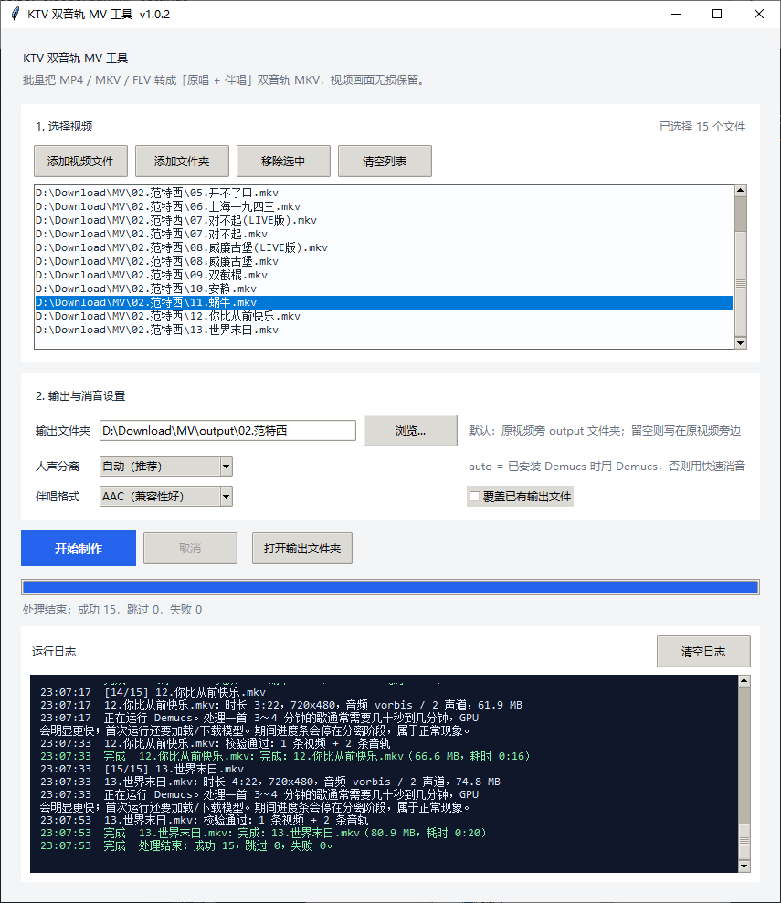

# KTV 双音轨 MV 工具 v1.0.3



把单音轨的 MP4 / MKV / FLV / F4V 批量转换成双音轨 MKV：

| 轨道 | 内容 | 处理方式 |
| --- | --- | --- |
| 视频 | 原画面 | 直接复制，不重新编码 |
| 音轨 1 | 原唱 | 直接复制源文件的第一条音轨，不重新编码 |
| 音轨 2 | 伴唱 | Demucs 人声分离，或内置的声道相消快速消音 |

支持输入：

```text
MP4  MKV  FLV  F4V
```

从 B 站下载的 FLV 可以直接拖进图形界面。输出统一为 MKV。

输出默认使用原文件名，只把扩展名改为 `.mkv`：

```text
我的歌.mp4  ->  我的歌.mkv
我的歌.flv  ->  我的歌.mkv
我的歌.mkv  ->  我的歌 (双音轨).mkv   # 防止覆盖源文件
```

音轨名写入为「原唱」「伴唱」，原唱是默认音轨。

旧版本生成的 `*.dual.mkv` 会被自动识别并跳过，重新处理后会得到不带 `dual` 的新文件；确认无误后可以手动删除旧文件。

---

## 1. 环境要求

- Windows 10 / 11（其他系统也能运行）
- Python 3.10 或更高版本
- FFmpeg（需要 `ffmpeg.exe` 和 `ffprobe.exe` 同时在 PATH 中）

检查：

```bat
ffmpeg -version
ffprobe -version
python --version
```

如果 FFmpeg 不在 PATH，可以在命令中用 `--ffmpeg` 和 `--ffprobe` 指定完整路径。

### Demucs / PyTorch

当前机器已经把 Demucs 和 PyTorch 安装在系统 Python 中。启动脚本会优先使用项目里的 `.venv`（如果存在），否则使用系统 `python`；程序本身也会依次检查 `.venv` 和系统 Python，找到可用的 Demucs 就自动使用。

如果需要重新安装或在新电脑上部署：

```bat
python -m pip install -U demucs -i https://pypi.org/simple/
```

也可以使用依赖文件：

```bat
python -m pip install -r requirements-optional.txt -i https://pypi.org/simple/
```

- 某些国内 pip 镜像没有 Demucs，所以安装时建议显式使用 `-i https://pypi.org/simple/`。
- Demucs 会自动安装 PyTorch 等依赖。
- 第一次分离会下载模型，需要联网，耗时较长；模型通常缓存在用户目录。
- 有 NVIDIA 显卡时，使用 CUDA 版 PyTorch 可以大幅加速。
- 没有安装 Demucs 时，程序会自动退回 `center` 快速消音并给出提示。

### 本机的 CUDA 配置

当前机器已安装 CUDA 版 PyTorch，RTX 3060 Ti 可以直接使用：

```bat
python -c "import torch; print(torch.__version__); print(torch.cuda.is_available()); print(torch.cuda.get_device_name(0))"
```

应看到类似：

```text
2.11.0+cu128
True
NVIDIA GeForce RTX 3060 Ti
```

Demucs 的 `auto` 设备会自动选择 CUDA。程序日志里的「GPU 会明显更快」指的就是这种情况。

如果换一台 NVIDIA 机器（Python 3.10）需要重装，可使用与当前驱动兼容的 CUDA 12.8 轮子：

```bat
python -m pip install --index-url https://download.pytorch.org/whl/cu128 "torch==2.11.0+cu128" "torchaudio==2.11.0+cu128"
```

安装前确认驱动支持 CUDA 12.8（`nvidia-smi` 右上角的 CUDA Version 不低于 12.8）。驱动较旧时，改用对应的 `cu126` / `cu124` 版本。

---

## 2. 图形界面（推荐日常使用）

双击：

```text
启动图形界面.bat
```

操作步骤：

1. 点「添加视频文件」或「添加文件夹」。支持 MP4 / MKV / FLV / F4V。
2. 输出文件夹会自动填成原视频旁边的 `output` 文件夹，可以手动修改；留空则写到原视频旁边。
3. 人声分离选择：
   - `自动（推荐）`：检测到 Demucs 就用 Demucs，否则用快速消音；
   - `Demucs 最佳质量`：需要 Demucs；
   - `快速消音（无需安装）`：不需要额外依赖。
4. 点「开始制作」。

处理过程中可以取消。取消会结束当前的 FFmpeg / Demucs 进程，已经完成的文件不受影响。

---

## 3. 命令行用法

### 处理单个文件

```bat
python ktv_mv.py "D:\MV\我的歌.mp4"
python ktv_mv.py "D:\MV\B站视频.flv"
```

输出：`D:\MV\我的歌.mkv`、`D:\MV\B站视频.mkv`

### 批量处理文件夹（包含子文件夹）

```bat
python ktv_mv.py "D:\MV" -o "D:\MV\双音轨"
```

### 使用 Demucs，并覆盖已有输出

```bat
python ktv_mv.py "D:\MV" -o "D:\MV\双音轨" --backend demucs --overwrite
```

### 先用快速消音试一下

```bat
python ktv_mv.py "D:\MV" --backend center
```

### 只查看处理计划，不生成文件

```bat
python ktv_mv.py "D:\MV" --dry-run
```

### 处理大文件时把临时目录放到剩余空间更大的磁盘

```bat
python ktv_mv.py "D:\MV" --temp-dir "E:\temp"
```

---

## 4. 常用参数

| 参数 | 说明 |
| --- | --- |
| `inputs` | 一个或多个视频文件 / 文件夹 |
| `-o, --output-dir` | 输出文件夹；省略时写入原视频旁边 |
| `--backend auto\|demucs\|center` | 人声分离方式，默认 `auto` |
| `--demucs-model` | Demucs 模型，默认 `htdemucs` |
| `--demucs-device auto\|cpu\|cuda` | Demucs 运算设备，默认 `auto` |
| `--instrumental-codec aac\|flac` | 伴唱音轨编码，默认 `aac` |
| `--bitrate` | 伴唱 AAC 码率，默认 `192k` |
| `--suffix` | 在文件名后额外加后缀，默认不加；例如 `--suffix _ktv` |
| `--recursive / --no-recursive` | 是否递归扫描子文件夹，默认递归 |
| `--overwrite` | 覆盖已有输出；默认跳过已存在的输出 |
| `--temp-dir` | 临时文件目录 |
| `--keep-temp` | 保留临时文件，便于排查问题 |
| `--ffmpeg` / `--ffprobe` | 指定可执行文件的完整路径 |
| `--dry-run` | 只打印计划 |
| `-v, --verbose` | 打印执行的命令和外部程序输出 |
| `--gui` | 启动图形界面 |

退出码：`0` 表示全部成功或跳过，`1` 表示有文件失败，`130` 表示用户取消。

---

## 5. 处理细节

1. 用 `ffprobe` 读取时长、分辨率、音频声道数和编码。
2. 把源文件的第一条音轨解码为 44.1 kHz 双声道 WAV。
3. 生成伴唱：
   - Demucs：运行 `python -m demucs --two-stems=vocals`，取 `no_vocals.wav`；
   - 快速消音：`(左声道 - 右声道) / 2`，再复制到左右声道。
4. 快速消音前检查左右声道是否几乎完全相同。老歌如果是“双声道单声道”，相消会把伴奏也一起消掉，程序会停止并提示改用 Demucs，不再输出静音伴唱。
5. 把伴唱裁剪或补静音到原音频的精确长度，避免多轨之间逐渐不同步；封装前再次检查伴唱是否接近静音。
6. 用 FFmpeg 封装：
   - 视频和原唱直接 `-c copy`；
   - 伴唱编码为 AAC 192k 或 FLAC；
   - 写入「原唱」「伴唱」轨道名；
   - 原唱设置为默认音轨。
7. 先写入临时 `.part.mkv`，校验通过后再原子替换为最终文件；失败不会留下半个输出文件。

如果输出文件名会覆盖源文件（例如源文件本来就是 `.mkv`），会自动改成 `原文件名 (双音轨).mkv`。源文件有多个音轨时，只把**第一条音频**作为原唱，并给出提示。字幕、附件不会复制到输出文件；视频只复制第一条主视频轨。

---

## 6. 常见问题

### 提示「未找到 FFmpeg」

把 FFmpeg 的 `bin` 目录加入 PATH，或者：

```bat
python ktv_mv.py "D:\MV" --ffmpeg "D:\ffmpeg\bin\ffmpeg.exe" --ffprobe "D:\ffmpeg\bin\ffprobe.exe"
```

### 提示「未检测到 Demucs」

使用系统 Python 安装：

```bat
python -m pip install -U demucs -i https://pypi.org/simple/
```

确认安装：

```bat
python -c "import demucs, torch; print(demucs.__version__, torch.__version__)"
```

如果使用过项目内的 `.venv`，程序会同时检查 `.venv` 和系统 Python；只要其中一个能导入 Demucs 就会自动使用。

### 报错「Can't write packet with unknown timestamp」

这是源视频的时间戳损坏：部分老 MKV（常见于 MPEG-4/Xvid 视频）只有 DTS，没有 PTS。封装成 MKV 时，Matroska 写入器无法处理缺失的 PTS。

v1.0.3 开始，封装前会自动加 `-fflags +genpts`，用 DTS 补齐缺失的 PTS。视频仍然直接复制，不重新编码，也不损失画质。

如果仍使用旧版本，请更新到 v1.0.3 后重新处理失败的文件。

### 提示「左右声道几乎完全相同」

这首歌是双声道单声道音源，`center` 快速消音无法分离人声，会连伴奏一起消掉。请安装 Demucs，并选择 `--backend demucs` 或图形界面的「Demucs 最佳质量」。

### 伴唱里还有歌声 / 声音变薄

`center` 是纯数学相消，只对正中央的人声有效，且会损失立体声。请使用 Demucs。

### 输出被跳过了

同名输出已经存在。加 `--overwrite`，或者删除旧文件。

### 处理很慢

这是正常现象。快速消音只是左右声道相减，几秒钟就能完成；Demucs 要运行神经网络，CPU 上会慢几十倍。

本机 CPU 实测：

- 3 分 22 秒的歌曲：约 1 分 33 秒完成；
- 4 分 23 秒的歌曲：约 2 分 12 秒完成；
- 第一次运行还要加载或下载模型，时间会更长。

切换到 RTX 3060 Ti 的 CUDA 后，21 秒测试片段从约 14～16 秒降到约 6～7 秒，整首歌也会明显更快。

CPU 模式下 Demucs 运行 1 分钟还没完成是正常的，界面会每 15 秒输出一次“仍在处理”。如果超过 10 分钟仍无进展，再检查 CPU/内存占用或改用 `--backend center`。先用 `--backend center` 验证流程、再用 Demucs 正式制作也可以。

### 磁盘空间不够

Demucs 需要保存解码后的 WAV 和分离结果。用 `--temp-dir` 指向空间更大的磁盘；确认足够空间后再处理长视频。

---

## 7. 版权提醒

请只处理你拥有版权或已获得授权的内容。工具不会绕过任何版权保护，输出的伴唱音轨仅供个人学习、练习或合法用途。
